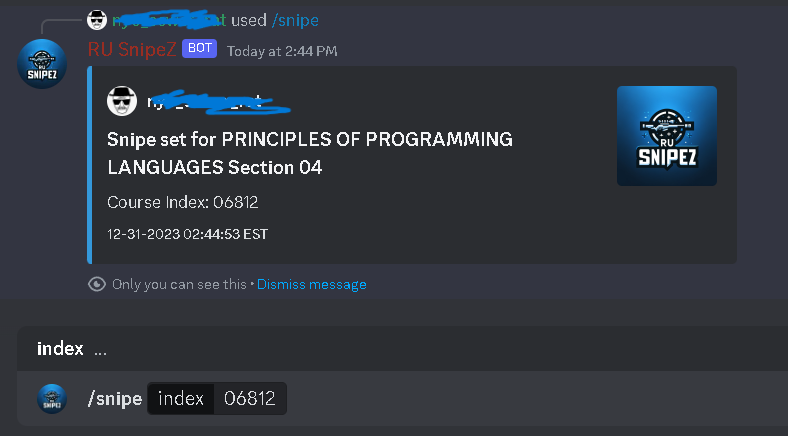
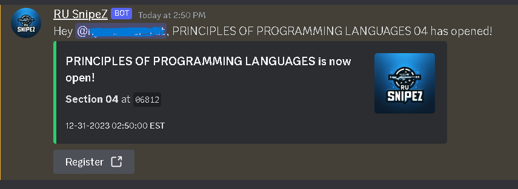
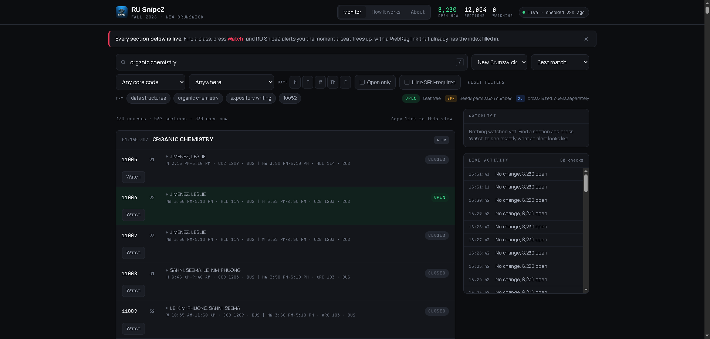
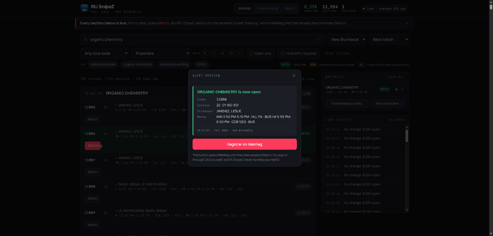
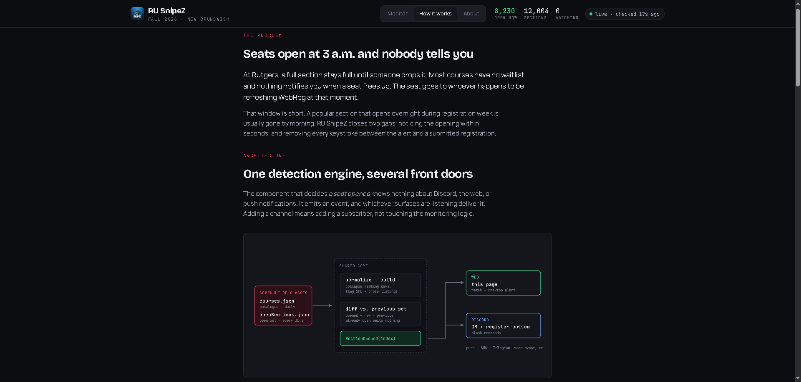
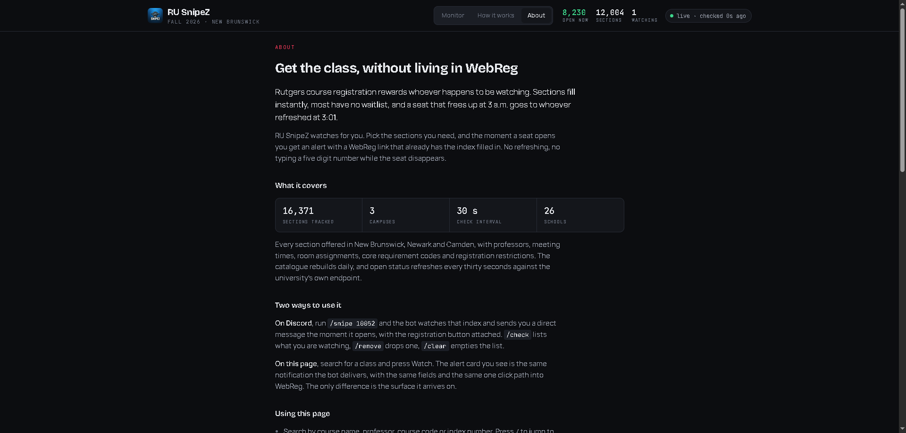

<div align="center">
  
  <h1>RU SnipeZ</h1>
  <p><strong>Live open-seat monitor for Rutgers course registration.</strong><br>
  Search sections across all three campuses, see the last date a section was observed open, watch the ones you need, and get a WebReg link with the index already filled in when an opening is observed.</p>
  <p>
    <a href="https://ru-snipez.vercel.app"><strong>ru-snipez.vercel.app</strong></a>
  </p>
  <p>
    
    <a href="https://github.com/dpat0103/RUSnipeZ/actions/workflows/ci.yml"></a>
    
  </p>
</div>

---

## The problem

Rutgers course registration rewards whoever happens to be watching. Sections fill in the first hour of enrollment, most have no waitlist, and when a spot opens back up, it goes to whoever refreshes WebReg at exactly the right second. During registration week that means checking a five digit index number by hand, over and over, sometimes at three in the morning, for days.

I was doing that for my own schedule and it was obviously a problem a computer should solve. Rutgers already publishes which sections are open, as an unauthenticated JSON endpoint anyone can call. Nobody was watching it for me. So I built something that would.

## What I built

**RU SnipeZ started as a Discord bot that watched course sections and messaged you when a seat opened.** You gave it an index, it polled the registrar, and when your section freed up you got a direct message with a button that opened WebReg with the index already typed in. It shipped to a real Discord community and people used it to get into classes. That original implementation is now archived in `legacy/v1/`; the maintained application is the website and its background collector.

<p align="center">
  
  
</p>

`/snipe 10052` starts watching an index. `/check` lists what you're watching, `/remove` drops one, `/clear` empties the list. That's the whole interface, because the whole point is to need it as little as possible.

## Why there's also a website

A Discord bot is a bad thing to put in front of someone who isn't already in your server. So I rebuilt the monitor as a live site anyone can open and try immediately, no account, no server invite.

**[ru-snipez.vercel.app](https://ru-snipez.vercel.app)** is that site, and it runs on real data. Search the catalogue and press **Watch** to preview an alert with the section details and a link into WebReg. The same website alert appears when a watched opening is detected while the page is running.

<p align="center">
  
</p>

<p align="center">
  
  
</p>

Filter by meeting day, campus location or core requirement code, sort by open seats or best match, and share any search as a URL. Click a section to expand it into exam date, prerequisites, the full meeting pattern and a copyable index.

<p align="center">
  
</p>

## How the detection actually works

### Daily last-seen-open history

Section rows, expanded details and the watchlist show the last **date a section was seen open**, using Eastern calendar dates. One GitHub Actions job checks the university-wide open set daily and saves per-term JSON on the dedicated `history-data` branch. Sections absent from a later snapshot retain their previous last-seen date. Same-day retries never double-count a day. Historical observations continue even when nobody visits the site.

The same-origin `/api/history` route serves this public JSON through Vercel's cache. Live status is separate: the open page checks `/api/open` every 30 seconds and delivers watched-seat alerts. Catalog, live status and history requests start concurrently; unavailable history never blocks search or live checks. No Cloudflare collector, R2 subscription, hosted database or purchased domain is required for this history design.

This is deliberately sampled history. A daily snapshot cannot establish an opening time or catch seats that open and close between snapshots. The UI says **Last seen open**, shows the last daily check, and does not calculate opening frequencies or durations from daily samples. Dates observed live during the current visit can appear with a `this visit` label. Existing dated evidence from the retired collector can seed the daily records. See [history setup](docs/seat-history.md).

The endpoint Rutgers exposes, `openSections.json`, returns a flat array of every currently open index. The naive approach is to check that array on a timer and fire a notification whenever your section appears in it, which means firing again on the next check, and the one after that, for as long as the seat stays open. V1 solved that with a ten minute cooldown per user, tracked in memory, which meant a bot restart during registration week could re-notify everyone whose sections happened to be open at that moment.

The actual fix was to stop asking a yes or no question and start computing a difference instead. Every cycle keeps the previous open set, subtracts it from the new one, and only what's left over is news:

```
                    ┌─ courses.json  (daily)  ──► catalogue build ──► static file on a CDN
Schedule of Classes ┤
                    ├─ openSections.json (daily) ──► GitHub Actions ──► history-data JSON ──► CDN
                    └─ openSections.json (30s, open tab) ──► cached proxy ──► browser set difference
                                                                                 │
                                                                                 ▼
                                                               alert + pre-filled WebReg link
```

A section that was already open is not in that difference, so it produces no event and needs no cooldown to suppress. The correctness comes from the shape of the computation, not from a rule bolted on to patch a symptom.

The 30 second interval isn't arbitrary either. Rutgers' own response declares `Cache-Control: max-age=30`, meaning any cache between here and the registrar might already be serving something up to 30 seconds old. Polling faster than that can't surface anything sooner, it just makes more requests that cannot possibly contain news. Matching the interval to what the server actually promises keeps detection at its real floor.

## What building this actually surfaced

Rutgers doesn't publish documentation for these endpoints. Everything below came from reading real responses, and each one changed something in the design.

**Two endpoints ignore the parameters they accept.** `courses.json` takes a `subject` filter and returns the entire campus catalogue regardless, which is good news since it means the whole catalogue is one request instead of one per department. `openSections.json` takes a `campus` filter and does the same thing in reverse: it returns every open section university-wide no matter which campus you ask for. That one cost real correctness until I caught it, because the demo's headline "sections open" counter was reading 11,444 on the Camden page, which is New Brunswick's number, not Camden's. Fixed by intersecting the response against the catalogue actually loaded for that campus, since that's the only list that knows what belongs where.

**Index numbers get reused across terms.** 3,059 index numbers valid in one recent term are also valid in a different term entirely, attached to unrelated courses. History is therefore isolated in one JSON file per term, indexed by section index; campus membership comes from the catalog. Browser watchlists are stored separately for each term so reused indexes cannot carry a Fall watch into Winter.

**Cross-listed sections have separate seat pools.** A class taught once but listed under two departments gets two index numbers, and they open and close independently. In a Fall 2026 snapshot, 254 of the 970 cross-listed pairs were in a split state, one side open and the other closed. Watching only one side can miss an opening, so the alert offers to add other cross-listed indexes present in the loaded campus catalog.

**A quarter of sections aren't actually registrable when they open.** In the Fall 2026 catalog, 2,902 of 12,004 New Brunswick sections carry a special permission requirement, meaning an open seat still needs department sign-off before you can add it. The site marks these with an SPN badge, includes the restriction in details and alert cards, and offers a filter to hide them. Watched SPN sections still trigger opening alerts.

**Course titles are written in a shorthand nobody types.** Expository Writing exists in the catalogue as `COLLEGE WRITING`. Chemistry courses show up as `ADV ORGANIC CHEM I`. A search box that only does exact substring matching returns nothing for the name a student actually knows, so search here scores tokens independently across title, code, instructor and subject, expands common abbreviations before matching, and ranks by relevance instead of requiring every word to hit.

| Someone searches for | And actually finds |
|---|---|
| `expository writing` | `01:355:101` COLLEGE WRITING |
| `microbiology health science` | `01:119:131` MICROBIOL HLTH SCI |
| `intro to computer science` | `01:198:111` INTRO COMPUTER SCI |
| `10052` | `01:013:120` LITERARY EGYPT |

## Where the product stops on purpose

The obvious next feature is automatic registration: skip the alert, skip the click, just enroll the student the second the seat opens. That requires holding a Rutgers NetID and password for every user, which turns a small utility into custody of thousands of university logins. That's a liability no convenience justifies, and it's also very likely the fastest way to get a project like this shut down by the university it depends on.

So the boundary is fixed: RU SnipeZ detects the opening and delivers the alert with the index already filled in. The student clicks through and signs in to WebReg through CAS themselves, exactly as they always would. It costs a few seconds. It also means there is no credential store here to secure, to breach, or to be trusted with in the first place.

## How it's built

Static frontend, daily observation pipeline, and thin API adapters:

```
src/rusnipez/soc/       term encoding, async API client, payload normalizer
src/rusnipez/catalog/   catalogue builder; daily CI rebuilds all campuses as artifacts
src/rusnipez/history/   daily observation builder and legacy snapshot importer
web/                   static HTML/CSS and catalog data; no framework or build step
web/js/                native ES modules for search, detection, data, rendering and browser wiring
web/functions/api/     Cloudflare Pages adapters for same-origin API routes
lib/                   Request/Response helpers for SOC, history and snapshot delivery
api/                   Vercel adapters for live SOC status and cached daily history
worker/                retired continuous collector; empty schedule and collection allowlist
scripts/devserver.py   local static server, cached SOC proxy and saved daily-history reader
tests/                 Python normalization/term tests; Node history, snapshot and frontend tests
.github/workflows/     CI validation, catalog artifact builds and daily history publication
legacy/v1/             the original bot, kept for reference
```

The frontend has no framework. Search renders as soon as the static catalog arrives. Live status is checked every 30 seconds through a cached proxy; historical JSON is fetched independently and refreshed hourly in the browser. A single daily Actions job publishes the history data branch without rebuilding the application. Catalog CI still uploads artifacts; deploying refreshed catalog files remains a separate step.

Rutgers sends no CORS headers, so live browser checks use same-origin Vercel or Pages adapters. Daily history is read from the public data branch through another cached same-origin adapter. The handlers use the web platform's standard `Request` and `Response` types.

## Try it yourself

The active registration term is **Winter 2027** (`02027`). Application code stays on
`main`, with short-lived branches for fixes and term rollovers. Catalogs and history
files include the term code; previous terms can remain archived alongside the active
one. Browser watches are isolated by term, so Winter starts with a fresh watchlist.

```bash
git clone https://github.com/dpat0103/RUSnipeZ.git
cd RUSnipeZ
pip install -e ".[dev]"
python -m rusnipez.catalog.build --term 02027 --campus NB --out web/data
python scripts/devserver.py
```

Then open `http://localhost:8788`. Generate a local daily observation with `python -m rusnipez.history.daily --term 02027 --out web/data/history-02027.json`. No Worker, cloud account or billing configuration is needed. See [daily history setup](docs/seat-history.md).

Use Node 24 for the Node tests, which exercise the built-in SQLite API.

```bash
pytest -q
ruff check src tests && ruff format --check src tests
node --test tests/*.test.mjs
```

CI runs Python and Node tests, lint and format checks on pushes to `main` and pull requests. It also runs a dependency audit, reporting findings as warnings. A second scheduled workflow rebuilds the catalogue daily, checks for truncated output, and uploads artifacts. It does not automatically update or deploy the website.

## Deploying your own copy

The catalog and frontend are static files. Live status needs the included SOC proxy; daily history needs the included Actions workflow on the repository's default branch. Follow [history setup](docs/seat-history.md) to publish the data branch and retire the old collector.

**Vercel:** deploy this repository using the included `vercel.json`. `/api/open` provides live status; `/api/history` reads the `history-data` branch. `HISTORY_REPOSITORY` defaults to `dpat0103/RUSnipeZ`; forks should override it. Remove the obsolete `HISTORY_API_BASE` setting.

**Cloudflare Pages:** the included `web/functions/api/` adapters provide the same live and daily-history endpoints. No background collector or R2 bucket is needed. Forks should set `HISTORY_REPOSITORY` to their public repository.

**A purely static host** needs a separately hosted API adapter, set through the `api-base` meta tag and permitted by the site's CSP. The Vercel deployment is the simplest complete setup for this repository.

## What's next

Daily history collection runs independently of visitors. Live website alerts still require an open, running tab; optional desktop notifications use the page's `Notification` API. A future **Web Push** implementation would require a separately budgeted background detection and subscription service.

After that: a detailed opening timeline, a nudge to watch both sides of a cross-listed pair automatically, and letting a student watch a **core requirement** instead of an index, so they can ask for any open section that satisfies their remaining Historical Analysis credit without knowing in advance which course they want.

## License

[MIT](LICENSE)
